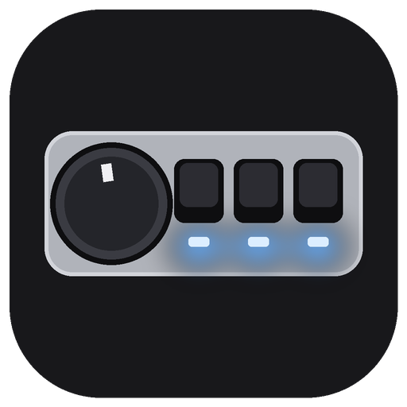
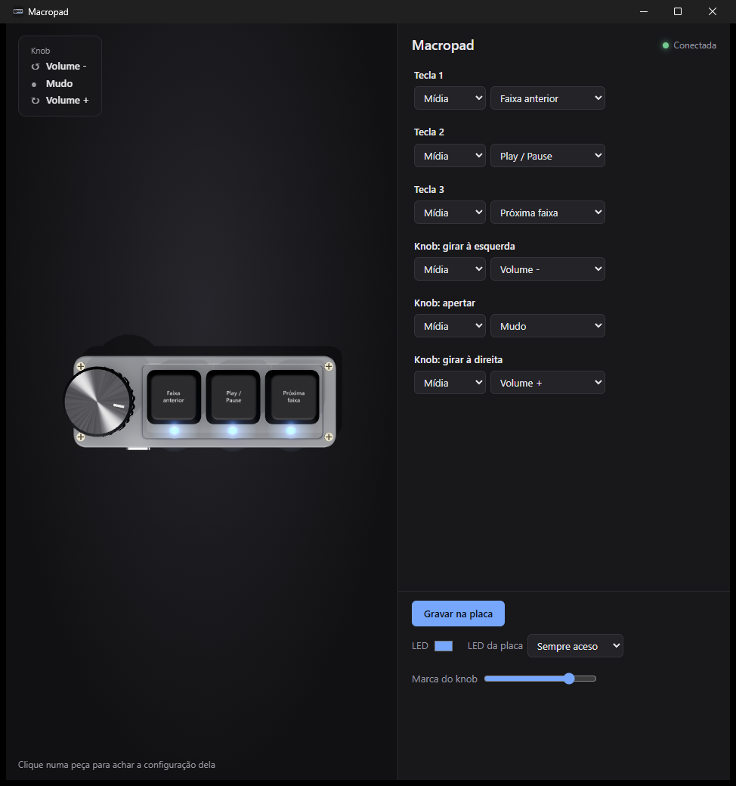

# Macropad



App para configurar a macropad chinesa de **3 teclas + knob** (chip CH57x, USB `1189:8890`), que vem sem programa do fabricante.



## O que faz

- Escolhe a ação de cada tecla e do knob (girar à esquerda, apertar, girar à direita): tecla com Ctrl/Shift/Alt/Win, mídia (volume, play/pause, faixas), mouse ou um **comando** (abre programa, pasta ou site).
- Grava tudo na própria placa: depois funciona em qualquer PC, sem o app aberto (só o tipo Comando precisa do app rodando em segundo plano, que ele liga sozinho no início do Windows).
- Mostra a placa ao vivo: a tecla afunda, o LED acende e o knob gira quando você mexe na placa de verdade.
- Escolhe o modo do LED da placa.

## Instalar

Baixe o [Macropad-Setup.exe](https://github.com/edsuuu/macropad/releases/latest/download/Macropad-Setup.exe) da última release. Instala só para o seu usuário, sem pedir administrador. Precisa do Windows 10/11 (com o WebView2, que já vem no 11).

## Compilar

Rust (edição 2024) e o Visual Studio com C++ (o `build.rs` usa o `rc.exe` do Windows SDK para pôr o ícone no `.exe`).

```bash
cargo build --release
```

Instalador: `.\tools\build-installer.ps1`, com o [Inno Setup 6](https://jrsoftware.org/isinfo.php). O CI gera o instalador em cada PR e publica a release `v<versão>` quando a versão do `Cargo.toml` muda no `main`.

## Créditos

O protocolo da placa vem do [ch57x-keyboard-tool](https://github.com/kriomant/ch57x-keyboard-tool), de kriomant. O desenho usa o [three.js](https://threejs.org).
